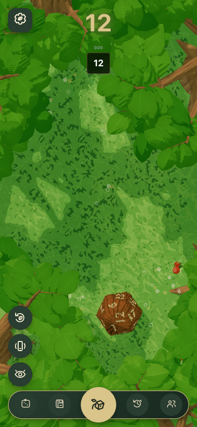
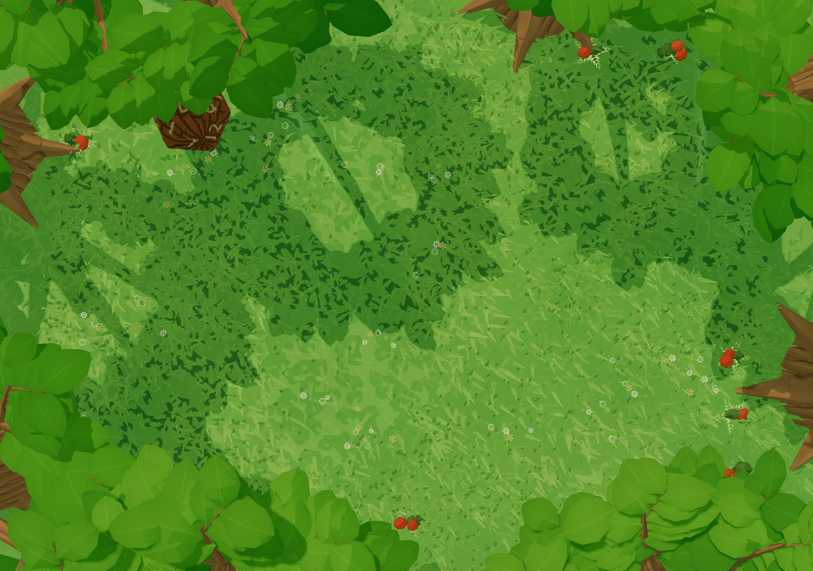
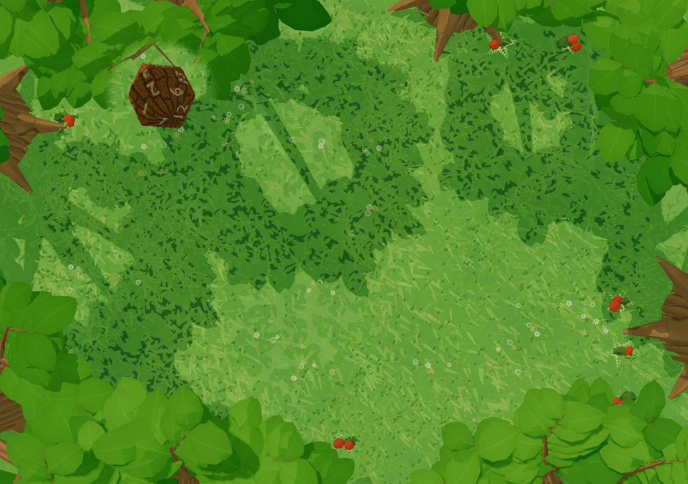

# Dice visibility corrections

## Result bounce

The result scrollport now includes the existing top inset as internal padding. The total keeps its original resting position and horizontal scrolling while its upward bounce remains inside the clip boundary.

This is the compiled application at 390 × 844. A real solo WASM roll produced the result; its existing CSS animation was paused at its apex for capture. No result, snapshot or account data was injected. Separate browser regressions sample five animation phases at phone and desktop widths, assert every clipping ancestor and preserve horizontal scrolling and Settings interaction.

## Woodland foliage reveal

| Reveal disabled | Reveal enabled |
| --- | --- |
|  |  |

These are controlled, matched captures of the actual Woodland renderer with identical camera, die pose, wind phase and lighting. They are not native-input or performance evidence. Only intervening leaves inside the projected circular window change; trunks and native shadow maps remain unchanged. The feathered edge uses a fixed pixel discard pattern rather than transparent sorting.

The reveal follows canonical interpolated die positions, supports the room's 30-die limit, updates during reduced ambient motion, respects foreground depth and clears on removal/disposal. Native pointer-drag, roll and removal were separately exercised at desktop and phone widths. All three worlds were also exercised through the compiled application with six standard dice at both widths.

## Qualification

- Local full build and lint passed.
- Normal and fixed-seed shuffled Vitest runs each passed 2,895 tests in 222 files.
- All eight HUD browser cases passed in Chrome.
- Independent bounded foliage and HUD reviews found no concrete P0–P2 findings.
- No model assets, physics, results, ownership, database migrations or deployment configuration changed.
- Phone-width desktop captures do not establish physical-phone, WebGL1 or sustained thermal/performance qualification.
