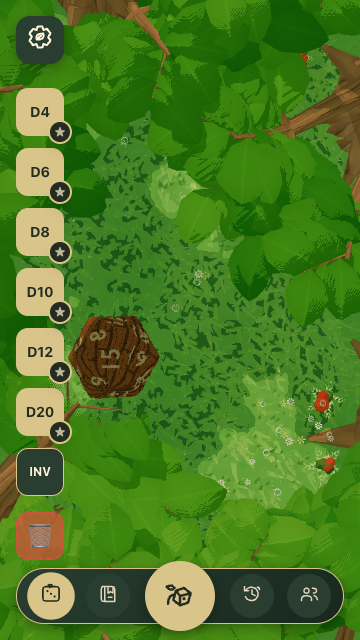

# Mobile dice menu correction

The open dice menu replaces the rotate/motion/hide-UI stack and uses its vacated lane above bottom navigation. The delete/clear button is pinned outside the scrolling shapes and inventory list, so opening the menu exposes a full-size 48px target without scrolling.

The screenshot shows the actual candidate application in Chrome at 360 × 640. Browser checks measure trash paint bounds against every clipping ancestor, hit-test the native target and activate it by coordinates, then observe the room worker's acknowledged zero-dice state. Closing the menu restores the stack; a history-overlay round trip preserves menu ownership.

Native touch checks enable CDP touch after ordinary desktop GPU admission because initial mobile/touch emulation is rejected by the existing device gate. No admission rule was changed. This establishes phone-width geometry and native touch delivery on a desktop GPU, not physical-phone or mobile-GPU qualification. The captured die pose is natural gameplay state, not a controlled physics result.

Existing favorite flyouts, inventory actions, trash drop-target identity, result animation and foliage reveal remain separate unchanged behaviors.
