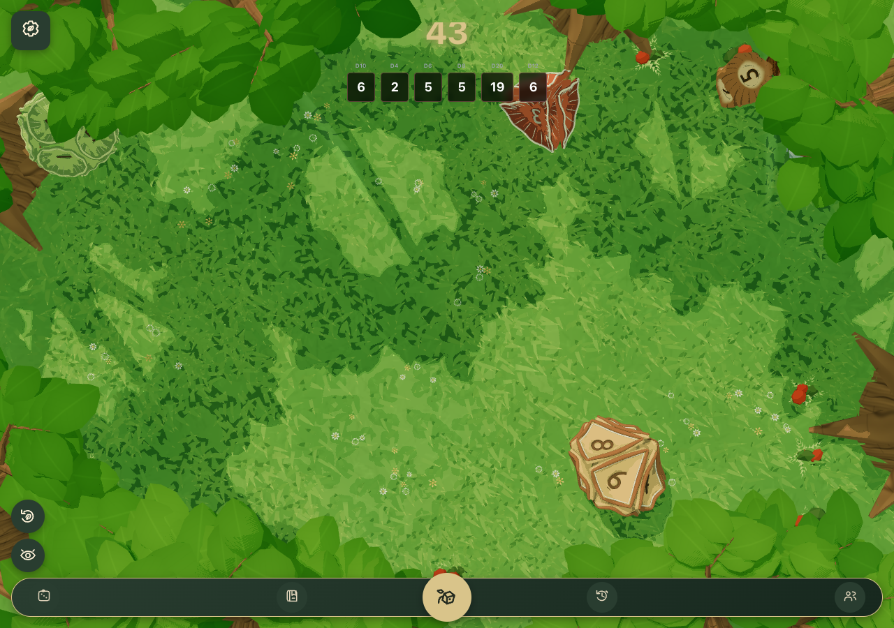
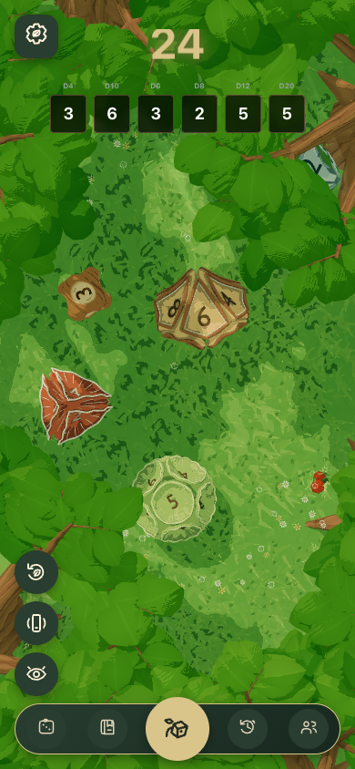
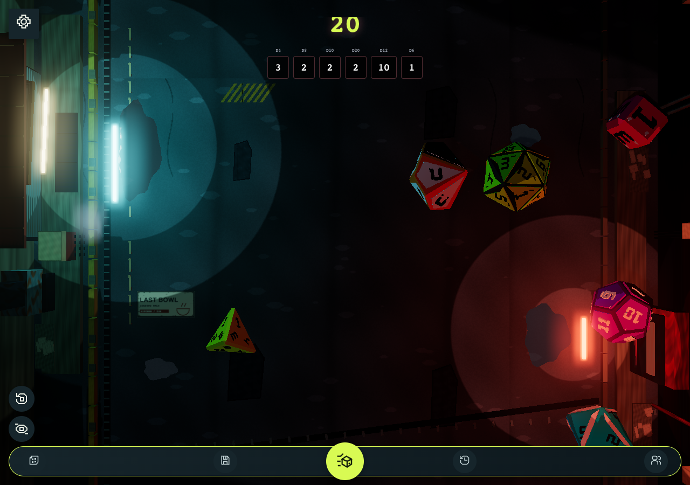
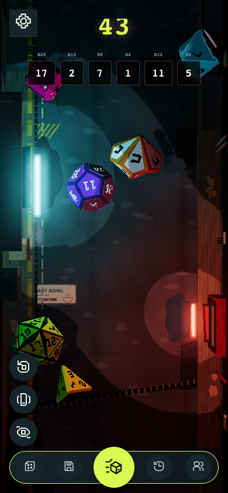
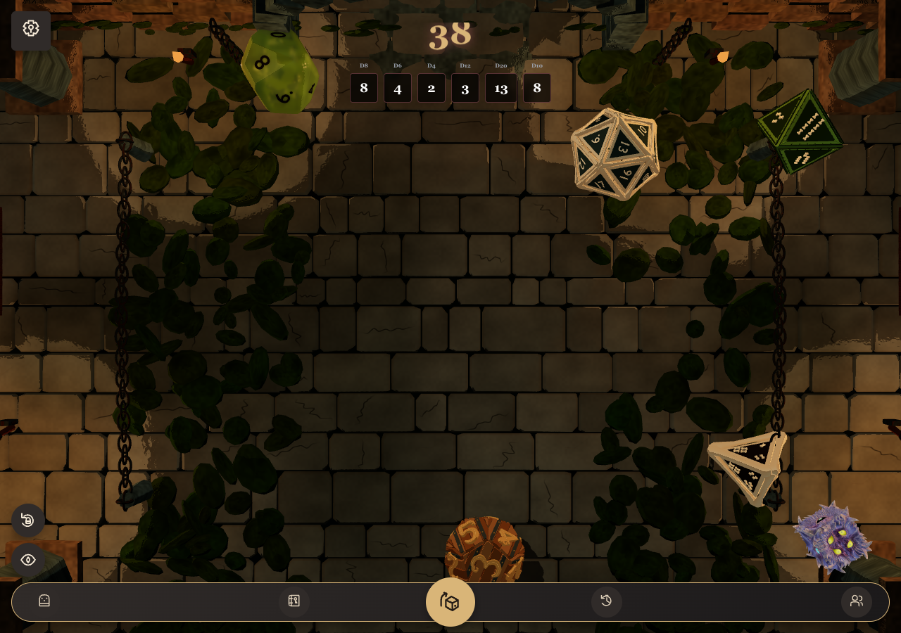
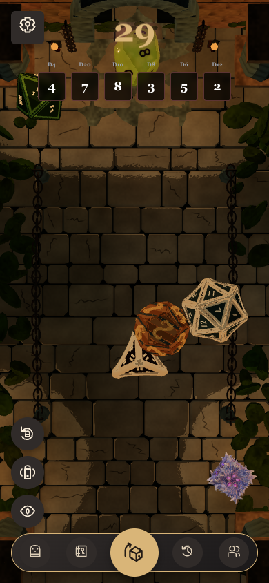

# Themed-worlds compiled-browser evidence

These are actual Chrome captures of the ordinary production bundle, using an empty local guest collection, the existing shape toolbar and natural WASM-room rolls. Each world shows D4/D6/D8/D10/D12/D20. No inventory grants, authenticated backend, source substitution, design mockup or fabricated roll state is used.

Desktop viewport: 1280 × 900. Phone-width viewport: 390 × 844. The latter is desktop Chrome viewport emulation, not a physical-device performance test. Captures intentionally show different naturally settled poses/results; they are not matched pixel comparisons.

## Woodland

## Cyberpunk CUTLINE

## Monster Dungeon

## Evidence and limits

The capture harness separately observes all six model deliveries, positive real WebGL draw work, no lost contexts/GL errors, native roll completion and no page errors. Screenshots were inspected for private data and rendering completeness. They contain only local guest game state and original environmental signage; there are no account names, invitation capabilities, browser chrome or unrelated windows.

Compact result labels use shapes rather than full asset names. The existing navigation and controls retain their layout while changing theme treatment. The desktop and phone views expose native scene framing; tiny marking readability, occluded dice, small signs and dark edge detail remain pose/viewport dependent. Static screenshots do not prove smooth animation, full offline support, multiplayer synchronization or sustained mobile frame pacing/thermal performance.

The PR records exact source identity, executed commands, CI/review outcomes and migration rollout notes. The developer's private execution receipts are not public links or a substitute for those hosted gates.
